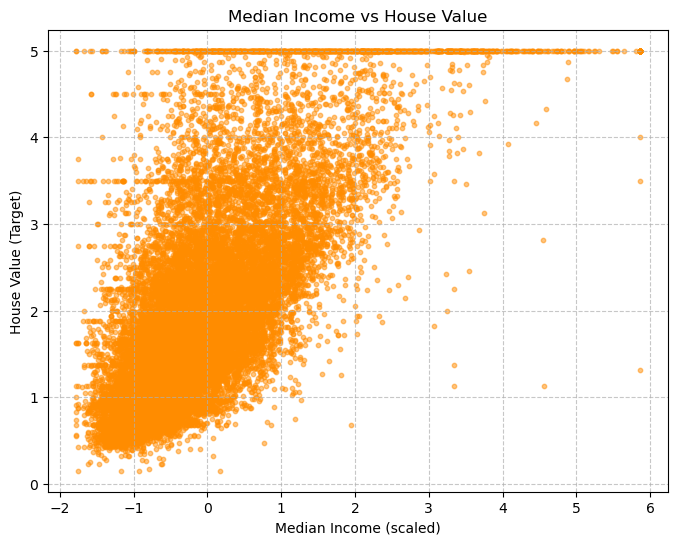
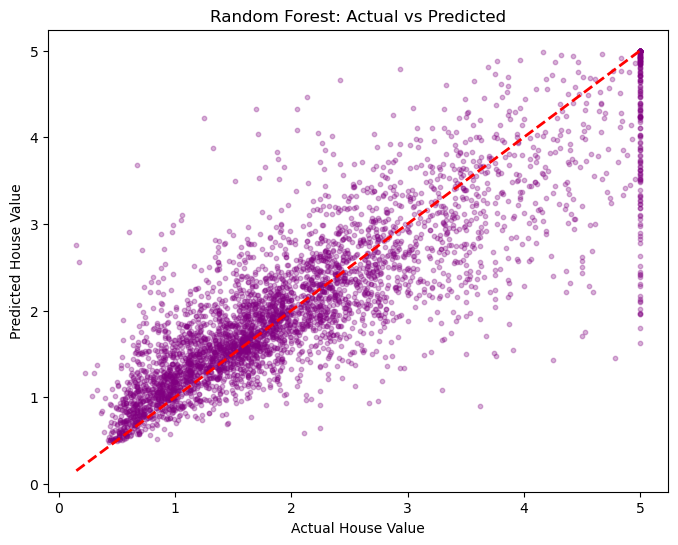
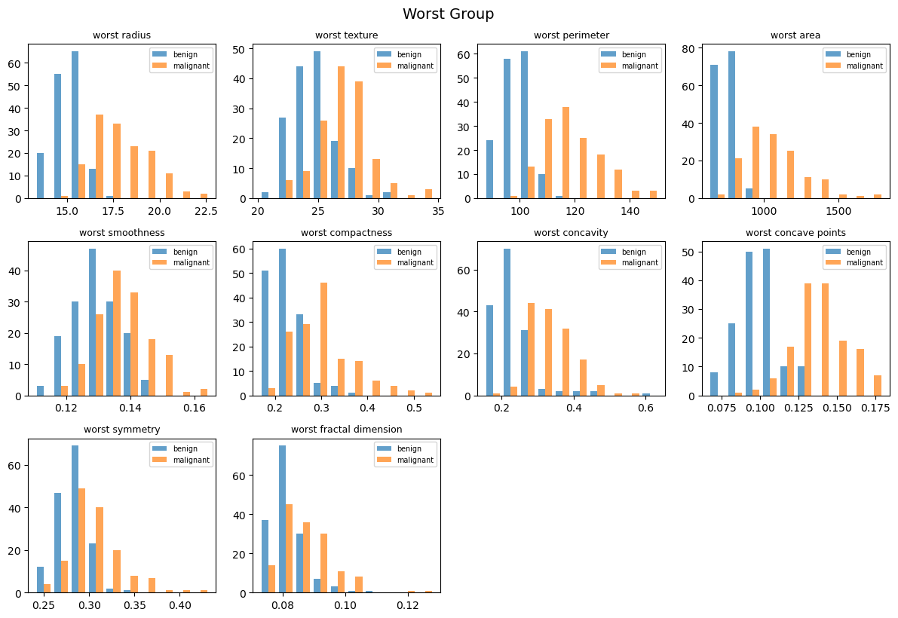

# ML Pipelines

Three machine learning tasks I did end to end: cleaning the data, doing EDA, then building, tuning and evaluating models. All the numbers below are what the notebooks actually printed, including the parts that look bad.

## a1 · House price EDA + regression

`a1-housing-eda/housing-eda-regression.ipynb`

California housing data, 30 cells: missing values, feature work, distributions and correlation, then five regression models compared.

| Model | MSE | R² |
|---|---|---|
| Linear regression | 0.65 | 0.50 |
| Polynomial regression | 0.55 | 0.58 |
| Decision tree | 0.50 | 0.62 |
| Random forest | **0.36** | **0.72** |
| SVR | 0.44 | 0.66 |

What I took away: most of the non-linearity here comes from location interactions. A linear model only reaches 0.50 even after feature work, and the tree models pick that up on their own. The 5 EDA and result figures are in `results/`.

## a2 · Supervised learning, tuning and evaluation

`a2-supervised-tuning/supervised-tuning.ipynb` + `assignment2.csv` + report

- Compared several supervised models on a real tabular dataset.
- Used **cross-validation plus grid search** for the hyperparameters instead of guessing one setting:
  - AdaBoost: CV **0.975 ± 0.028**
  - XGBoost: CV **0.938 ± 0.057**
- Both models score 1.0 on the test set. I wrote in the report that the split is probably too easy, so I do not treat that as the real performance.

## a3 · From clustering to classification

`a3-clustering-classification/clustering-to-classification.ipynb` + `assignment3_data.csv`

- The dataset came with no description, so I started with scaling, dimension reduction and clustering to see how many groups were in there.
- Then I built a classification task on top of what the clustering showed.
- Tuning result: `batch_size=32, epochs=50, lr=0.001, patience=5`, best validation loss 0.0702.
- 5-fold CV: `[1.0, 0.972, 0.972, 0.943, 1.0]`, mean **0.9775**, test accuracy **0.9815**.

## Result figures

`results/` has 19 figures exported from the notebooks (EDA distributions, correlation heatmap, cluster plots, confusion matrices, learning curves).

| | |
|---|---|
|  |  |
|  |  |

## Environment

```bash
pip install numpy pandas scikit-learn matplotlib seaborn xgboost
```
