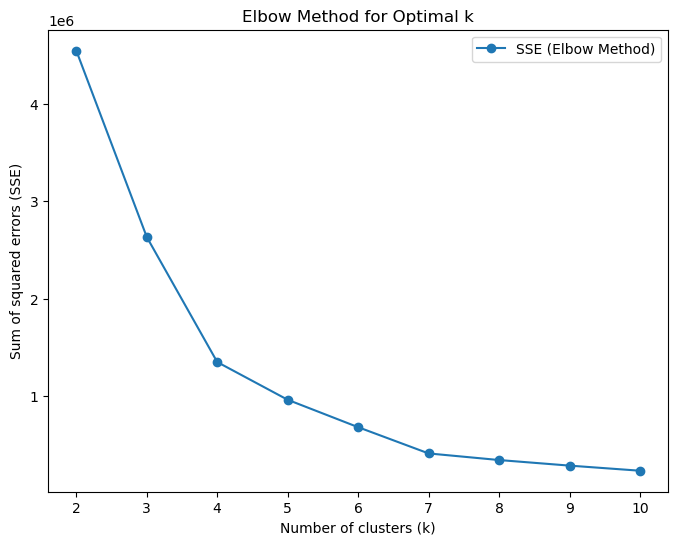

# ML Pipelines

三个完整的机器学习流程：从原始数据预处理、探索性分析，到建模、调参、交叉验证与评估。结果都来自 notebook 的真实输出，没有挑好看的写。

## a1 · 房价数据 EDA + 回归建模

`a1-housing-eda/housing-eda-regression.ipynb`

加州房价数据集，30 个 cell 走完：缺失值处理 → 特征工程 → 分布与相关性分析 → 五个回归模型对比。

| 模型 | MSE | R² |
|---|---|---|
| 线性回归 | 0.65 | 0.50 |
| 多项式回归 | 0.55 | 0.58 |
| 决策树 | 0.50 | 0.62 |
| 随机森林 | **0.36** | **0.72** |
| 支持向量回归 | 0.44 | 0.66 |

结论：这个数据集的非线性主要来自地理位置的交互项，线性模型加特征也只能到 0.50，树模型直接吃掉这部分。5 张 EDA 与结果图在 `results/`。

## a2 · 监督学习调优与评估

`a2-supervised-tuning/supervised-tuning.ipynb` + `assignment2.csv` + 报告

- 在真实表格数据上对比多种监督学习算法。
- 用**交叉验证 + 网格搜索**选超参，不是手调一组就交：
  - AdaBoost：CV **0.975 ± 0.028**
  - XGBoost：CV **0.938 ± 0.057**
- 两个模型在测试集上都是 1.0 —— 报告里也写了这可能是划分过于干净导致的，不把它当作真实水平吹。

## a3 · 从聚类到分类

`a3-clustering-classification/clustering-to-classification.ipynb` + `assignment3_data.csv`

- 拿到的是一份**没有说明的数据集**：先做标准化、降维与聚类，判断里面有几组结构。
- 再基于聚类结果构造分类任务，训练分类器。
- 调参结果：`batch_size=32, epochs=50, lr=0.001, patience=5`，最优验证损失 0.0702。
- 5 折交叉验证：`[1.0, 0.972, 0.972, 0.943, 1.0]`，均值 **0.9775**，测试准确率 **0.9815**。

## 结果图

`results/` 里是从 notebook 导出的 19 张图（EDA 分布、相关性热图、聚类可视化、混淆矩阵、学习曲线）。

| | |
|---|---|
|  |  |
|  |  |

## 环境

```bash
pip install numpy pandas scikit-learn matplotlib seaborn xgboost
```
